# Official Postman screenshot references

Retrieved 17 November 2026 from official Postman documentation. These files are the unmodified source image bytes. They are not captures of your installed Postman build, and no live signed-in account was used.

## How to read version labels

- `Latest (v12)` is the documentation branch, not proof of the exact app build pictured.
- `asset_version_hint` is taken from the official image URL. The current docs sometimes reuse v11 or v10 images.
- Original capture dates and exact build numbers are unknown unless independently recorded in your own baseline.
- These are evidence and interaction references. Proposed redesign behavior lives in the specs; a screenshot alone cannot establish permissions, sync behavior or data handling.

## At a glance

| ID | Reference | Image generation | Best use |
| --- | --- | --- | --- |
| 01 | [Request workbench and response](screenshots/01_request_workbench.png) | v12 | Cropped request composer, query parameters and successful JSON response; surrounding navigation is not visible. |
| 02 | [Postman application layout](screenshots/02_app_interface.png) | v12 | Official annotated application overview showing major navigation and workbench areas. |
| 03 | [Environment selection](screenshots/03_environment_selector.png) | v12 | Active environment selector and available environments. |
| 04 | [Inspect a variable value](screenshots/04_variable_inspection.png) | v12 | Variable value popover opened from a request URL, showing the value and environment scope. |
| 05 | [Reference a Vault secret](screenshots/05_vault_reference.png) | v12 | Using a Vault reference as the value of a secure variable. |
| 06 | [Collection run results](screenshots/06_collection_run_results.png) | v12 | Collection run summary and request/test results. |
| 07 | [Debug a request in the Console](screenshots/07_console_debugging.jpg) | v10 | Console opened from a failed response in the official archive; image path identifies v10. |
| 08 | [Native Git connection controls](screenshots/08_native_git_connection.png) | v12 | Native Git connection menu, including the option to disconnect a workspace. |
| 09 | [Invite people and choose roles](screenshots/09_workspace_invite.png) | v12 | Workspace invitation controls with role assignment. |
| 10 | [Workspace visibility](screenshots/10_workspace_visibility.png) | v12 | Workspace visibility settings in official documentation. |
| 11 | [Comments across a collection](screenshots/11_collection_comments.png) | v12 | Aggregated comments with links to the associated collection elements. |
| 12 | [Inline comment and reply](screenshots/12_inline_comment_reply.png) | v12 | Replying to a comment anchored to part of a request or example. |
| 13 | [Review a collection change](screenshots/13_pull_request_diff.jpg) | v11 | A collection pull-request diff reproduced in current documentation; image path identifies v11. |
| 14 | [Resolve element conflicts](screenshots/14_resolve_conflicts.jpg) | v10 | Conflict resolution for forked Postman elements; image path identifies v10. |
| 15 | [Request authorization](screenshots/15_request_authorization.jpg) | v11 | Authorization configuration in the official v11 documentation. |
| 16 | [Test script authoring and AI assistance](screenshots/16_test_scripts_and_ai.jpg) | v11 | Populated post-response JavaScript test editor with a selection-based legacy Postbot action. |

## Individual references

### 01 — Request workbench and response

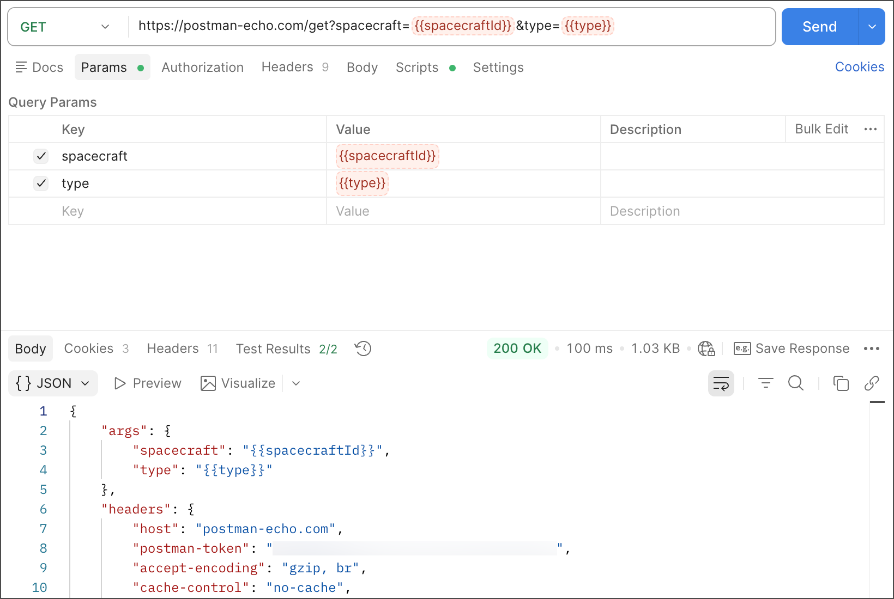

- Source page: [https://learning.postman.com/docs/use/send-requests/requests](https://learning.postman.com/docs/use/send-requests/requests)
- Original image: [https://assets.postman.com/postman-docs/v12/postman-request-builder-v12-01.png](https://assets.postman.com/postman-docs/v12/postman-request-builder-v12-01.png)
- Documentation: Latest (v12); image path: v12.
- Original size: 1640 × 1100 pixels.
- Retrieved: 2026-11-17. Exact installed build and original capture date: unknown.

**What to study:** Study the hierarchy between request editing, Send, response status and response content. Capture the full shell separately.

### 02 — Postman application layout

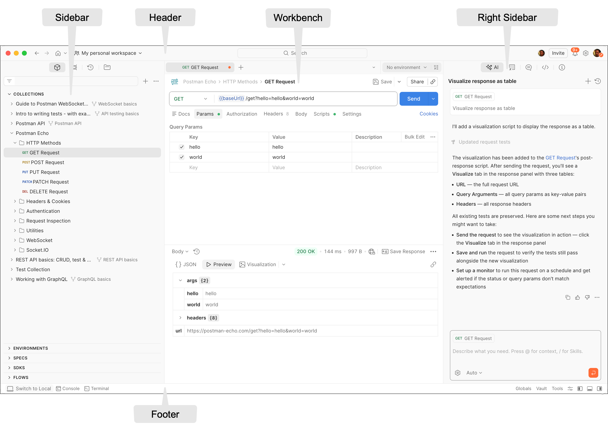

- Source page: [https://learning.postman.com/docs/getting-started/basics/navigating-postman](https://learning.postman.com/docs/getting-started/basics/navigating-postman)
- Original image: [https://assets.postman.com/postman-docs/v12/workspace-diagram-02-28-26-v2.png](https://assets.postman.com/postman-docs/v12/workspace-diagram-02-28-26-v2.png)
- Documentation: Latest (v12); image path: v12.
- Original size: 2996 × 2110 pixels.
- Retrieved: 2026-11-17. Exact installed build and original capture date: unknown.

**What to study:** Study the division between global navigation, workspace resources, tabs, request workbench and context tools. The source contains its own annotations.

### 03 — Environment selection

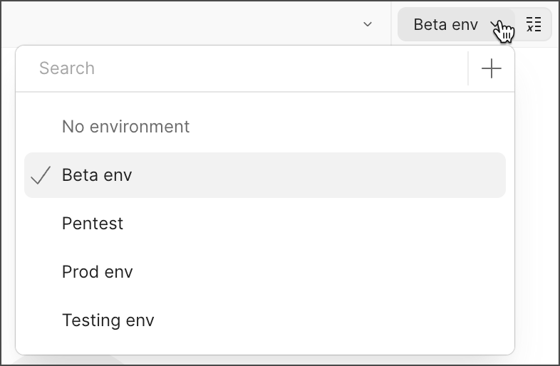

- Source page: [https://learning.postman.com/docs/use/send-requests/variables/managing-environments](https://learning.postman.com/docs/use/send-requests/variables/managing-environments)
- Original image: [https://assets.postman.com/postman-docs/v12/environment-selector.png](https://assets.postman.com/postman-docs/v12/environment-selector.png)
- Documentation: Latest (v12); image path: v12.
- Original size: 786 × 514 pixels.
- Retrieved: 2026-11-17. Exact installed build and original capture date: unknown.

**What to study:** Make the selected target environment clear before a request runs.

### 04 — Inspect a variable value

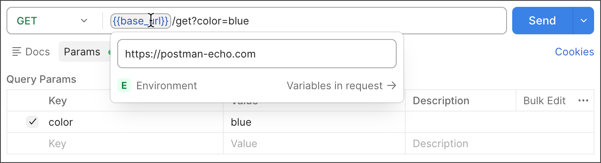

- Source page: [https://learning.postman.com/docs/use/send-requests/variables/variables](https://learning.postman.com/docs/use/send-requests/variables/variables)
- Original image: [https://assets.postman.com/postman-docs/v12/variables-editor-v12.png](https://assets.postman.com/postman-docs/v12/variables-editor-v12.png)
- Documentation: Latest (v12); image path: v12.
- Original size: 1394 × 380 pixels.
- Retrieved: 2026-11-17. Exact installed build and original capture date: unknown.

**What to study:** Make an effective variable value and its originating scope inspectable at the point of use; this image is not the full environment editor.

### 05 — Reference a Vault secret

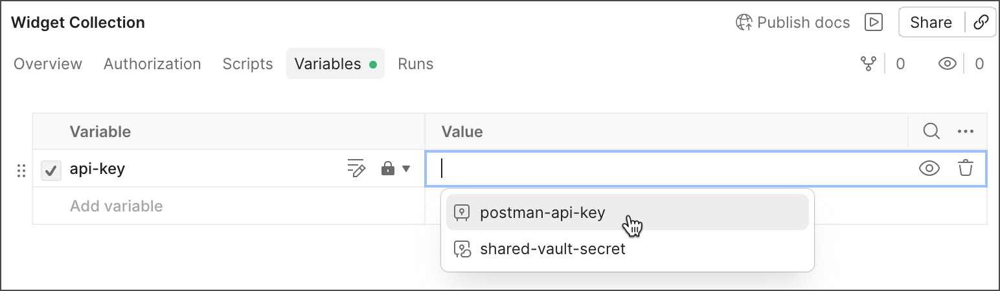

- Source page: [https://learning.postman.com/docs/use/postman-vault/use-vault-secrets](https://learning.postman.com/docs/use/postman-vault/use-vault-secrets)
- Original image: [https://assets.postman.com/postman-docs/v12/set-vault-secret-as-secure-variable-v12-08.png](https://assets.postman.com/postman-docs/v12/set-vault-secret-as-secure-variable-v12-08.png)
- Documentation: Latest (v12); image path: v12.
- Original size: 1544 × 450 pixels.
- Retrieved: 2026-11-17. Exact installed build and original capture date: unknown.

**What to study:** Expose the source of a secret without exposing its plaintext value.

### 06 — Collection run results

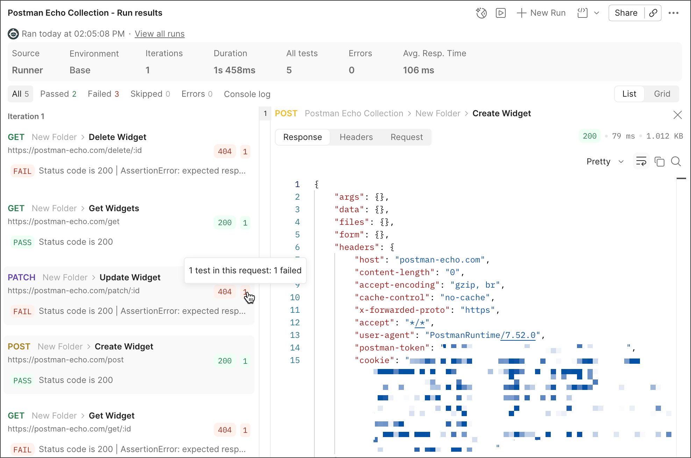

- Source page: [https://learning.postman.com/docs/tests-and-scripts/running-collections/intro-to-collection-runs](https://learning.postman.com/docs/tests-and-scripts/running-collections/intro-to-collection-runs)
- Original image: [https://assets.postman.com/postman-docs/v12/intro-to-collection-runs-debug-v12-01.png](https://assets.postman.com/postman-docs/v12/intro-to-collection-runs-debug-v12-01.png)
- Documentation: Latest (v12); image path: v12.
- Original size: 1976 × 1312 pixels.
- Retrieved: 2026-11-17. Exact installed build and original capture date: unknown.

**What to study:** Support fast scanning, failed-test filtering and direct navigation to the affected request.

### 07 — Debug a request in the Console

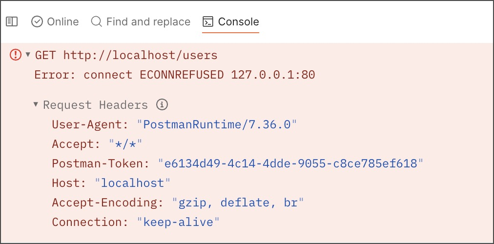

- Source page: [https://learning.postman.com/v11/docs/use/send-requests/response-data/troubleshooting-api-requests](https://learning.postman.com/v11/docs/use/send-requests/response-data/troubleshooting-api-requests)
- Original image: [https://assets.postman.com/postman-docs/v10/console-pane-opened-from-response-v10-22.jpg](https://assets.postman.com/postman-docs/v10/console-pane-opened-from-response-v10-22.jpg)
- Documentation: v11 archive, with legacy v10 image; image path: v10.
- Original size: 1012 × 500 pixels.
- Retrieved: 2026-11-17. Exact installed build and original capture date: unknown.

**What to study:** Inspect the link between a failed request and its diagnostic detail. Treat layout and terminology as legacy reference.

### 08 — Native Git connection controls

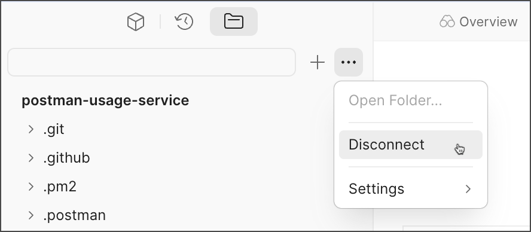

- Source page: [https://learning.postman.com/docs/use/native-git/sync](https://learning.postman.com/docs/use/native-git/sync)
- Original image: [https://assets.postman.com/postman-docs/v12/native-git-disconnect-v12.png](https://assets.postman.com/postman-docs/v12/native-git-disconnect-v12.png)
- Documentation: Latest (v12); image path: v12.
- Original size: 888 × 388 pixels.
- Retrieved: 2026-11-17. Exact installed build and original capture date: unknown.

**What to study:** Study how local/project state is exposed; this is not evidence of every Local/Cloud transition.

### 09 — Invite people and choose roles

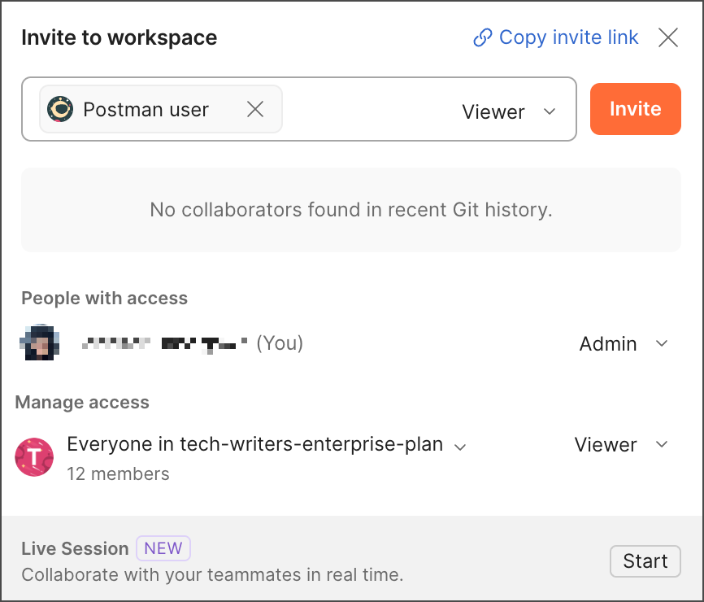

- Source page: [https://learning.postman.com/docs/collaborating-in-postman/using-workspaces/internal-workspaces/manage-workspaces](https://learning.postman.com/docs/collaborating-in-postman/using-workspaces/internal-workspaces/manage-workspaces)
- Original image: [https://assets.postman.com/postman-docs/v12/invite-to-workspace-v12-21-0.png](https://assets.postman.com/postman-docs/v12/invite-to-workspace-v12-21-0.png)
- Documentation: Latest (v12); image path: v12.
- Original size: 866 × 740 pixels.
- Retrieved: 2026-11-17. Exact installed build and original capture date: unknown.

**What to study:** Make the audience and access level explicit before sharing.

### 10 — Workspace visibility

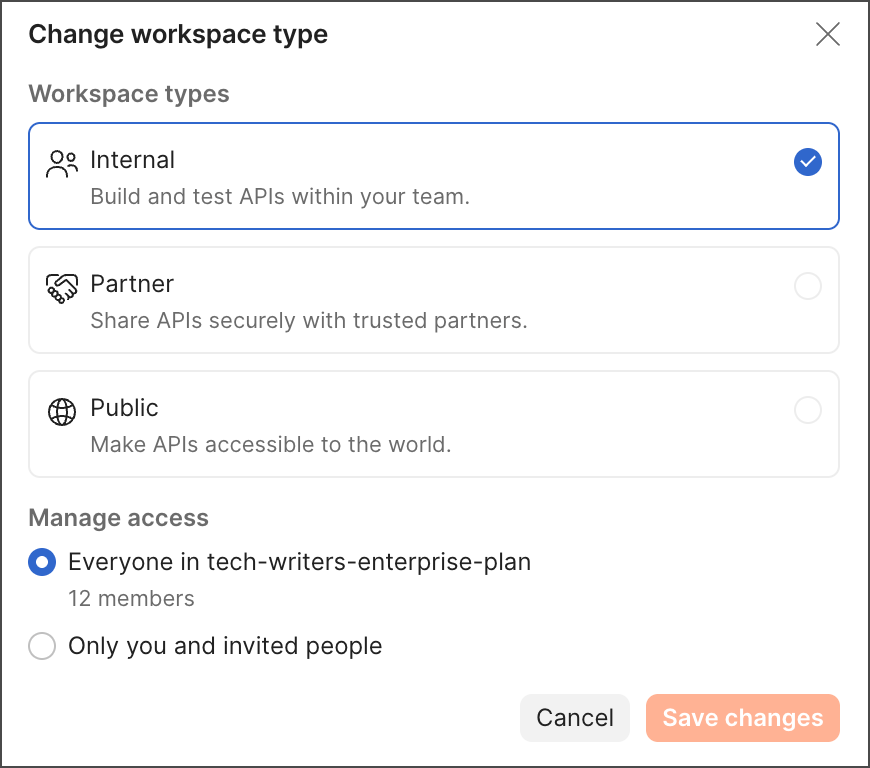

- Source page: [https://learning.postman.com/docs/collaborating-in-postman/using-workspaces/internal-workspaces/manage-workspaces](https://learning.postman.com/docs/collaborating-in-postman/using-workspaces/internal-workspaces/manage-workspaces)
- Original image: [https://assets.postman.com/postman-docs/v12/change-workspace-type-v12-21-0.png](https://assets.postman.com/postman-docs/v12/change-workspace-type-v12-21-0.png)
- Documentation: Latest (v12); image path: v12.
- Original size: 870 × 768 pixels.
- Retrieved: 2026-11-17. Exact installed build and original capture date: unknown.

**What to study:** Separate workspace visibility from a person’s role and collection-specific access.

### 11 — Comments across a collection

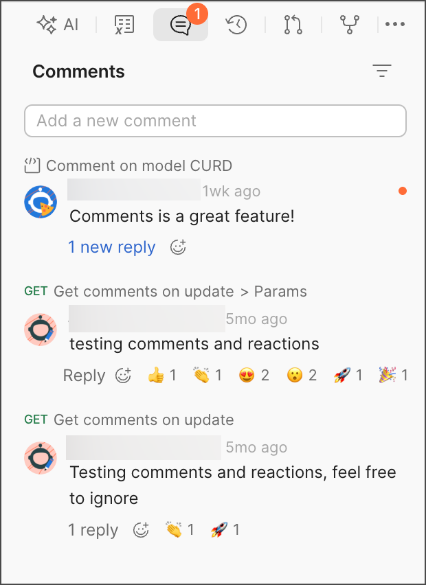

- Source page: [https://learning.postman.com/docs/collaborating-in-postman/comments](https://learning.postman.com/docs/collaborating-in-postman/comments)
- Original image: [https://assets.postman.com/postman-docs/v12/comment-aggregate-v12.png](https://assets.postman.com/postman-docs/v12/comment-aggregate-v12.png)
- Documentation: Latest (v12); image path: v12.
- Original size: 620 × 852 pixels.
- Retrieved: 2026-11-17. Exact installed build and original capture date: unknown.

**What to study:** Keep the conversation linked to the relevant object and its revision.

### 12 — Inline comment and reply

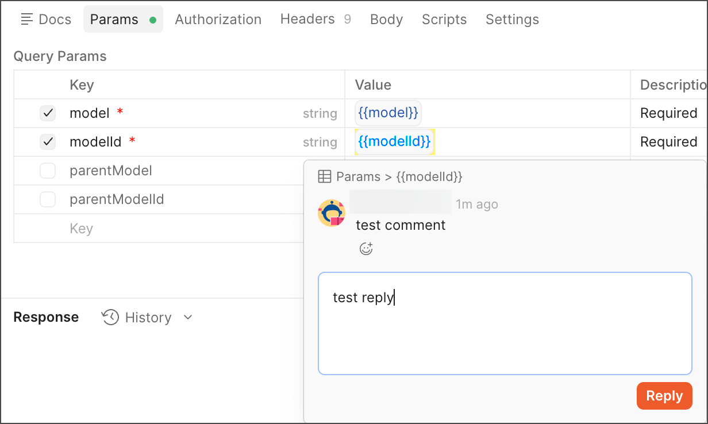

- Source page: [https://learning.postman.com/docs/collaborating-in-postman/comments](https://learning.postman.com/docs/collaborating-in-postman/comments)
- Original image: [https://assets.postman.com/postman-docs/v12/request-reply-to-inline-comment-v12.png](https://assets.postman.com/postman-docs/v12/request-reply-to-inline-comment-v12.png)
- Documentation: Latest (v12); image path: v12.
- Original size: 1232 × 738 pixels.
- Retrieved: 2026-11-17. Exact installed build and original capture date: unknown.

**What to study:** Preserve context, thread state and navigation back to the anchor.

### 13 — Review a collection change

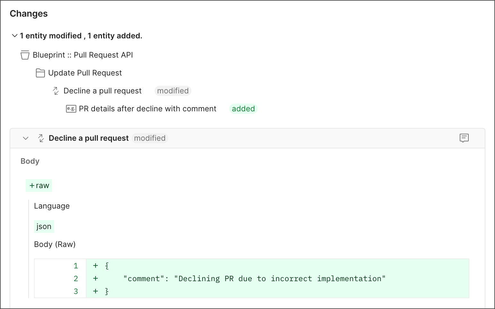

- Source page: [https://learning.postman.com/docs/collaborating-in-postman/using-version-control/reviewing-pull-requests](https://learning.postman.com/docs/collaborating-in-postman/using-version-control/reviewing-pull-requests)
- Original image: [https://assets.postman.com/postman-docs/v11/pull-request-review-view-diff-v11.jpg](https://assets.postman.com/postman-docs/v11/pull-request-review-view-diff-v11.jpg)
- Documentation: Latest (v12), with legacy v11 image; image path: v11.
- Original size: 1544 × 966 pixels.
- Retrieved: 2026-11-17. Exact installed build and original capture date: unknown.

**What to study:** Design diff readability, reviewer context and an explicit review outcome. This is Postman element version control, not a Git-provider PR.

### 14 — Resolve element conflicts

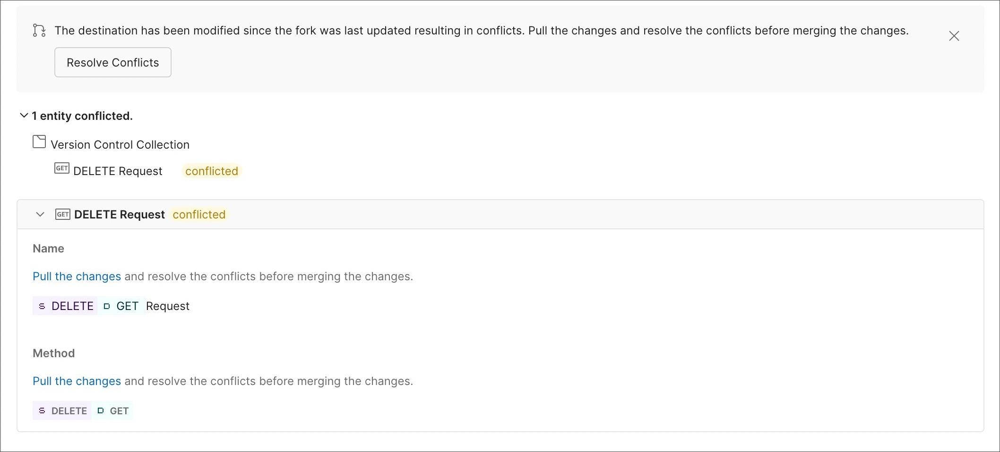

- Source page: [https://learning.postman.com/docs/collaborating-in-postman/using-version-control/reviewing-pull-requests](https://learning.postman.com/docs/collaborating-in-postman/using-version-control/reviewing-pull-requests)
- Original image: [https://assets.postman.com/postman-docs/v10/resolve-conflicts-v10-2.jpg](https://assets.postman.com/postman-docs/v10/resolve-conflicts-v10-2.jpg)
- Documentation: Latest (v12), with legacy v10 image; image path: v10.
- Original size: 2116 × 958 pixels.
- Retrieved: 2026-11-17. Exact installed build and original capture date: unknown.

**What to study:** Show source/destination values and affected object before a resolution is applied. Do not equate this screen with local Git conflict resolution.

### 15 — Request authorization

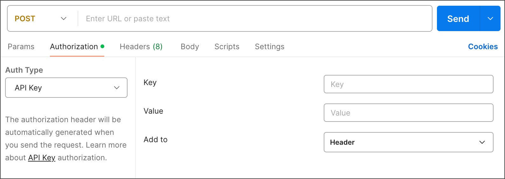

- Source page: [https://learning.postman.com/v11/docs/use/send-requests/authorization/specifying-authorization-details](https://learning.postman.com/v11/docs/use/send-requests/authorization/specifying-authorization-details)
- Original image: [https://assets.postman.com/postman-docs/v11/authorization-tab-v11-2.jpg](https://assets.postman.com/postman-docs/v11/authorization-tab-v11-2.jpg)
- Documentation: v11 archive; image path: v11.
- Original size: 1588 × 564 pixels.
- Retrieved: 2026-11-17. Exact installed build and original capture date: unknown.

**What to study:** Use the interaction as a legacy reference; current inheritance labeling differs and must follow current docs.

### 16 — Test script authoring and AI assistance

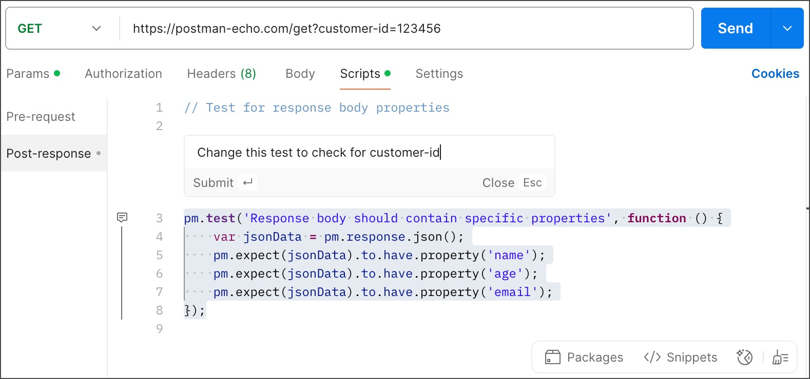

- Source page: [https://learning.postman.com/v11/docs/tests-and-scripts/write-scripts/test-scripts](https://learning.postman.com/v11/docs/tests-and-scripts/write-scripts/test-scripts)
- Original image: [https://assets.postman.com/postman-docs/v11/postbot-test-context-v11-41.jpg](https://assets.postman.com/postman-docs/v11/postbot-test-context-v11-41.jpg)
- Documentation: v11 archive; image path: v11.
- Original size: 1578 × 740 pixels.
- Retrieved: 2026-11-17. Exact installed build and original capture date: unknown.

**What to study:** Study code/editor layout only. Postbot branding and controls are historical, not the current Agent Mode spec.

## Gaps to fill with your own captures

The pack does not show every current viewport, theme, permission role or interaction state. Prioritize your current environment editor, import preview, runner setup, auth inheritance, denied secret access, pending synchronization, offline editing and concurrent changes. Follow `capture_checklist.md`.

For a coherent redesign, recapture the core workflow with one demo workspace, one fixture set and the same window size. Treat the legacy images as interaction research, not a current visual specification.

These screenshots remain third-party reference material. No license to reuse Postman branding or screenshot assets in a new product is granted by this pack.
